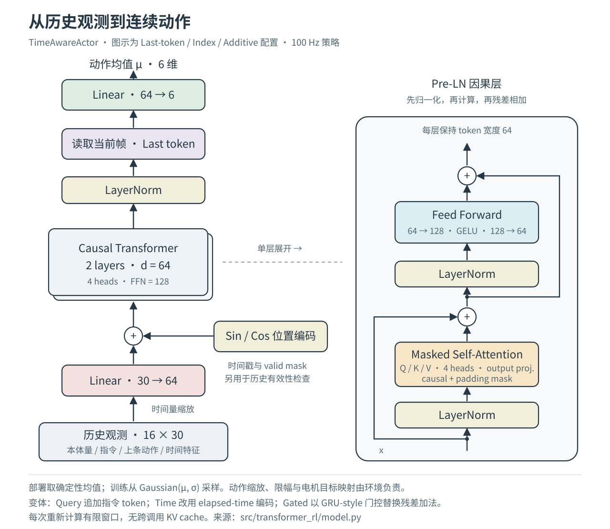
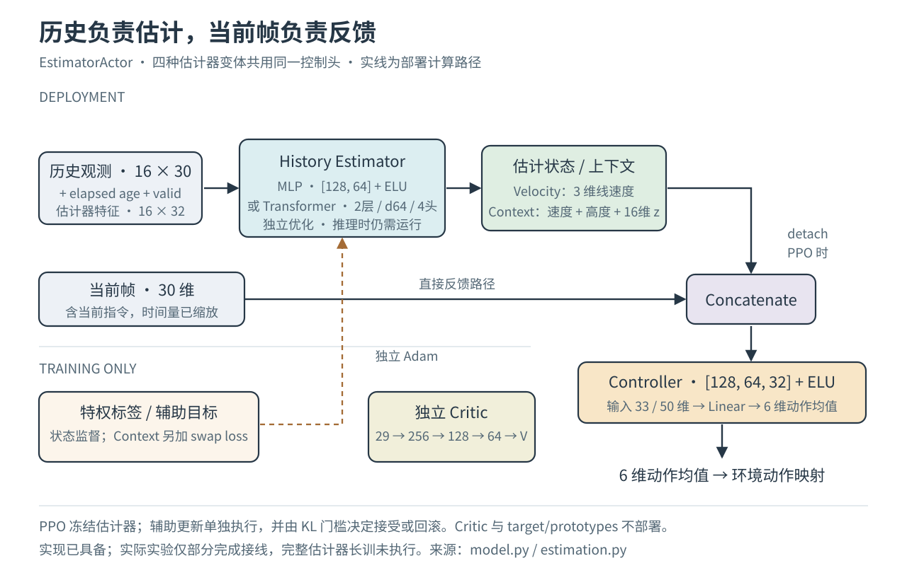

# transformer_rl

这个项目实现轻量 Transformer 运动控制策略、独立 PPO 和可恢复的训练运行管理，同时保留 MLP、历史编码器与 Transformer 的研究对照。

我们关心机器人能否完成任务、站立时是否漂移、不同高度能否保持、动作是否平稳，以及这些表现需要多少训练和推理开销。对照集中于单帧 MLP、历史 MLP 编码器与当前帧直连，以及多种 Transformer。

代码使用 PyTorch，不依赖 RSL-RL。`main` 上的正式训练接入采用单一结构化策略：100 Hz 策略、200 Hz 物理、包含当前帧的 5 帧输入（40 ms 跨度）、35D Actor、独立 81D Critic 和 6 维动作；轮支路输出速度目标。课程按连续训练曝光推进，人工评估独立执行。原生仿真接入仍在验证中，代码存在不代表正式训练或实机验收已经完成。

旧研究路径的 31 帧窗口、1 kHz 物理参考、自动评估与选型流程各自保留，不作为上述正式路径的默认设置。

[网络架构](#网络架构) · [使用方法](#使用方法) · [开发与版本管理](docs/DEVELOPMENT.md) · [变更记录](CHANGELOG.md) · [文档](#文档)

## 网络架构

正式路径采用身体语义编码、短时因果 Transformer、动作 Query 和当前帧直连；状态估计作为训练辅助，特权观测仅进入 Critic 或监督标签。策略、PPO、任务与原生仿真分别管理，不在网络中启动 SDK、安排评价或处理进程控制。

### 保留的研究对照

35D 路径使用 `FramePolicy`，独立 81D Critic 仅用于训练。10 个预设涵盖两个单帧 MLP、两个历史 MLP，以及末帧读出、当前帧 Query、门控残差与容量扩展 Transformer。默认 Transformer 均值网络有 477,062 参数，另有约 18 万、102 万和 227 万参数档位。参数量按结构需要选择；先比较架构收益，再检查容量变化。

完整使用说明见 [35D 训练、对比与部署](docs/FRAME_TRAINING.md)，理论见 [历史网络与能力保持设计](docs/FRAME_POLICY_DESIGN.md)。`frame` 入口管理该路径；下述 30D 时间编码接口是独立研究路径，两者的观测与检查点格式各自验证。

图文说明见[35D 策略网络架构](docs/FRAME_ARCHITECTURE.md)，展开两类 MLP、Transformer 编码器与读出、独立 Critic 和 100 Hz 部署数据流。[网络结构比较与实验设计](docs/NETWORK_COMPARISON.md)介绍更广泛的结构特点。

### 时间编码对照结构

所有网络读取相同的本体观测、命令和动作历史。当前默认窗口是16帧，每帧30维，包含传感器数据年龄及实际采样间隔。

| 配置名 | 想回答的问题 |
|---|---|
| `last_token_attention` | 标准因果 Transformer，从最后一个当前帧读出动作，表现如何？ |
| `index_attention` | 在相同位置编码下，独立的命令 query 是否比最后一帧读出更好？ |
| `time_attention` | 用真实时间差编码历史，是否比只用帧位置更合适？ |
| `gated_attention` | 门控残差能否让优化和控制更稳定？ |
| `supervised_attention` | 加入显式状态估计监督，是否能改善时序表示？ |
| `history_mlp` | 同样的历史信息，普通 MLP 能做到什么程度？ |

Transformer默认使用64维、2层、4个注意力头。辅助监督单独分组，因为它增加了训练信息，不能把收益全算到结构上。网络尺寸和历史长度都在配置里，命名不绑定机器人型号或实验轮次。

### 直接控制：历史观测 → 动作

下图对应实际实现的 Last-token 路径：16帧历史经过因果自注意力，读取当前帧表示，
输出6维连续动作均值。右侧展开一个 **Pre-LN** 层；Query、时间编码和门控残差变体在图下注明。



训练时使用高斯策略采样，部署时取确定性均值。动作缩放与电机目标映射由环境负责。
实现见 [`TimeAwareActor` 与 `_CausalBlock`](src/transformer_rl/model.py)。

### 估计器分离：历史估计 → 当前帧反馈

第二种结构让历史编码器估计速度或上下文，当前帧直接进入控制头。
估计器使用独立优化器，PPO 更新时冻结它；部署时仍需执行估计器。



实现见 [`EstimatorActor`](src/transformer_rl/model.py) 和[独立辅助优化](src/transformer_rl/estimation.py)。

## 使用方法

### 安装与静态检查

需要 Python 3.11 或更新版本，建议使用独立环境：

```bash
python tools/check_repository.py
```

该命令只分析文件、配置和版本元数据，不导入模型。模型、单元、接口、性能和仿真验证在 Kaiser 上执行；在其已配置环境中按需安装 `.[test,train,export]` 并运行对应检查。`inspect` 会创建模型以显示配置和参数量，也在 Kaiser 执行。

### 旧 35D 研究训练与选型

在 Kaiser 检查研究路径的 100 Hz 模型：

```bash
python -m transformer_rl frame inspect --config configs/frame_training.json
```

从既有 V6 课程冻结独立研究场景，再生成对比计划：

```bash
python -m transformer_rl frame prepare-chassis \
  --source-root ../robot_rl/isaac_wheeled_rl_train \
  --curriculum contracts/v6_new_asset_training_v1.json \
  --directory runs/prepared --round confirm
python -m transformer_rl frame plan \
  --spec runs/prepared/study.json --root runs/network_comparison
```

以下命令启动新训练，随后依据独立评测与 CPU 延迟选择合格 Transformer：

```bash
python -m transformer_rl frame run --root runs/network_comparison
python -m transformer_rl frame select --root runs/network_comparison
```

每个阶段复测旧技能，退步触发学习状态回退；失败尝试计入预算。作业产出 TensorBoard、检查点、逐场景评测、ONNX/TorchScript 与执行合同。`selection.json` 同时记录最佳 Transformer 和整体最佳结构；任务、覆盖率或延迟不合格时不会指定赢家。

### 时间编码研究实验

实验规格定义网络变体、训练seed、预算和评估场景。通用配置中的
`environment_factory`默认为`null`，先填写实际环境工厂和参数，再生成计划：

```bash
python -m transformer_rl.experiment_cli plan \
  --spec configs/learning_curves.json --root runs/comparison
```

运行已生成的计划并汇总结果：

```bash
python -m transformer_rl.experiment_cli run \
  --root runs/comparison --max-parallel 2

python -m transformer_rl.experiment_cli summarize \
  --root runs/comparison
```

每项实验有独立进程、优化器、检查点和日志。默认只对最终检查点执行完整场景评估，中间检查点用于恢复和后续分析。已有输出目录不会被覆盖。

### 接入自己的任务

环境实现 `VectorEnv` 接口，提供观测、reward、终止状态以及 reset 前的终态。网络只生成控制量；动作缩放、通信队列和底层控制器仍由环境或控制层负责。

`previous_issued_action`表示上一条已经发出的指令，不意味着电机已经执行。已知的数据年龄与未知延迟也分开编码。这样的区分是为了让训练和真实控制链路有清楚的对应关系。

[`examples/isaaclab_task.py`](examples/isaaclab_task.py)提供 Isaac Lab 接入示例，SDK进程生命周期由专用worker管理。
配置与运行细节见[实验使用说明](docs/EXPERIMENTS.md)、[训练方法](docs/KAISER_ESTIMATOR_RUN.md)和[交互训练控制台](docs/TRAINING_CONSOLE.md)。控制台支持更新边界暂停、同进程继续与保存退出；保存退出后的恢复会重置仿真回合。

## 文档

- [开发流程、源码与运行产物边界、版本管理](docs/DEVELOPMENT.md)
- [变更记录](CHANGELOG.md)
- [35D 策略网络架构与部署数据流](docs/FRAME_ARCHITECTURE.md)
- [35D 训练、课程保持、选型与部署](docs/FRAME_TRAINING.md)

- [研究结论、实时控制取舍与代码索引](docs/RESEARCH_CONCLUSION.md)
- [训练预算与网络选型计划](docs/TRAINING_EVALUATION_PLAN.md)
- [估计器与控制网络训练方案](docs/ESTIMATOR_TRAINING_PLAN.md) / [策略网络结构与控制应用设计复核](docs/TRANSFORMER_APPLICATIONS.md)
- [训练方法](docs/KAISER_ESTIMATOR_RUN.md)
- [本机与SSH训练启停控制](docs/TRAINING_CONTROL.md)
- [实验配置、并发和结果汇总](docs/EXPERIMENTS.md)
- [MLP稳态基线](docs/MLP_STEADY_STATE_BASELINE.md) / [稳定性统计口径](docs/STABILITY_METRICS.md)
- [优化敏感性复验](docs/KAISER_SENSITIVITY_RECHECK.md) / [浮点一致性问题](docs/BEHAVIOR_PRECISION.md)
- [检查点与ONNX导出](docs/EXPORT.md)
- [视觉修复审查](docs/CHASSIS_GEOMETRY_REVIEW.md)
