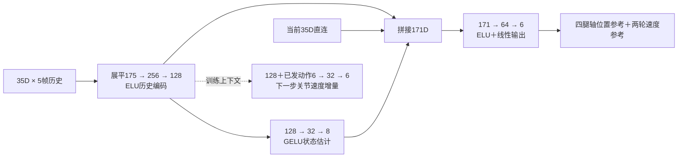

# 单一运动控制网络与训练对接

本文对齐当前网络代码、Lab正式采样路径与配置，说明实际张量接口及尚待验证的设计。系统分层见[系统架构](ARCHITECTURE.md)，启停与课程见[使用说明](USAGE.md)。网络已接入训练；接线完成不代表完整课程、长期优化稳定性或实机能力已通过。

历史MLP候选的结构、参数量和配置见[第11节](#11-历史mlp候选)，与默认Transformer共用环境及训练接口。

**采用现有拓扑的轻量尺寸：一层32D空间门控注意力、两层64D时间门控注意力、五Query读出、35D×5帧Actor、185D独立Critic。** 保留身体分组、完整特征门控、状态估计、当前帧直连与腿／轮共享解码器。

## 1. 实现状态与固定接口

| 项目 | 网络代码 | 环境／训练对接状态 |
|---|---|---|
| Actor输入／输出 | `float32[B,5,35] → float32[B,6]` | 保持现有35D字段和六轴顺序 |
| 空间／时间主干 | 32D／64D，层数1／2 | 已接入Lab正式路径 |
| Critic | `185→256→128→64→1`，ELU | Lab环境提供182D，再追加3D估计速度 |
| Critic拼接 | `model.critic_features(environment182, raw_state8)` | 已接入，两个输入均detach；字段语义差异见5.3节 |
| PPO batch与checkpoint | 按配置校验Critic宽度、记录对应归一化标识 | 同规格严格恢复；改变尺寸或recipe需新会话 |
| 地形／课程／运行状态 | 属于环境与训练层 | 以各会话冻结recipe、状态与回执为准 |

`B`为批量。正式策略50Hz、物理200Hz、闭链position12／velocity6。当前冻结机械源为`v6_232mm_stop105_nominal_v1`，膝内角限位40–105°；106–107°是待辨识的止挡误差范围，当前未开启止挡随机化。模型不会自动装载新课程，也不实现机械闭链、链传动或电机时延补偿。

## 2. 网络框图


[可编辑SVG](figures/formal-policy.svg)与[绘图源码](figures/formal-policy.py)。绘图尺寸读取正式配置，参数量按层公式计算；不导入网络或启动仿真。

Actor与Critic分别持有参数和Adam。环境不导入网络；采样器复用一次Actor前向的估计量拼接Critic输入。图中虚线支路表示门控信号，底部虚线框为仅训练使用的Critic、预测头与探索。

## 3. Actor每帧35D

索引采用Python半开区间。输入先检查来源和有限值，再执行固定缩放及`[-100,100]`裁剪；不使用运行中更新的均值／方差。

| 索引 | 维数 | 字段 | 定义与缩放 |
|---|---:|---|---|
| `0:3` | 3 | 准入速度命令 | `[vx,vy,wz]`，m/s、m/s、rad/s；本车`vy=0` |
| `3:4` | 1 | 准入高度命令 | m，乘5 |
| `4:7` | 3 | 机身角速度 | 机身坐标rad/s，乘0.5 |
| `7:10` | 3 | 重力方向 | 世界单位重力旋转到机身坐标 |
| `10:14` | 4 | 四输出轴位置偏差 | 相对资产标称姿态的同轴成对规范坐标，rad |
| `14:16` | 2 | 轮位置兼容槽 | 恒0，编码器主动忽略 |
| `16:22` | 6 | 六输出轴速度 | rad/s，乘0.1 |
| `22:28` | 6 | 上次已发出动作 | 归一化动作，不是未限幅采样值或物理响应 |
| `28:33` | 5 | 模式one-hot | `NORMAL, STAIR, SLOPE, RECOVERY, JUMP`，编号0…4 |
| `33:34` | 1 | 跳跃请求增高 | m，乘5；非跳跃模式为0 |
| `34:35` | 1 | 命令时钟 | 秒，`min(clock,5)` |

四腿轴是链传动后的同轴输出坐标，不直接等同于四个独立解剖关节角。成对位置只去除共同绕圈，不能分别wrap两轴。轮绝对角度不作为时钟输入。

窗口为`t−80ms…t`共5帧，包含当前帧，不额外等待80ms。reset或控制epoch变化时切断历史；不足五帧时复制新边界首帧，不跨回合或脚本接管拼接。保存原始帧与索引，PPO用当前权重重算；可以打乱端点，不能打乱窗口内部顺序或用旧latent替代新前向。两层时间编码仍覆盖同一个80ms窗口；无RNN、跨调用隐状态或KV cache。

## 4. Actor层尺寸与数学

| 模块 | 尺寸 | 参数共享／处理 |
|---|---|---|
| 命令投影 | `11→32` | 每帧相同权重 |
| 机身投影 | `6→32` | 每帧相同权重 |
| 腿投影 | `6→32` | 左右共享；输入`q2+dq2+previous_action2` |
| 轮投影 | `2→32` | 左右共享；输入`dq1+previous_action1` |
| 身体身份 | 可学习`6×32` | 顺序：命令、机身、左腿、右腿、左轮、右轮 |
| 空间块 | 32D、2头、FFN`32→64→32` | 一层Pre-LN语义mask注意力、完整特征残差门控 |
| 空间融合 | LayerNorm32；`192→64`；LayerNorm64 | 每帧六token拼成一个时间token |
| 位置编码 | 固定`5×64`sin／cos | 相对位置`−4…0` |
| 时间块 | 64D、4头、FFN`64→128→64` | 两层，末端LayerNorm64 |
| Query读出 | `当前身体32+命令11=43→64` | 五Query共享时间memory的K／V投影 |
| 状态头 | `64→32→8` | 一个状态Query |
| 腿解码 | `95→64→32→2` | `Query64+局部6+共享25`，左右共享 |
| 轮解码 | `91→64→32→1` | `Query64+局部2+共享25`，左右共享 |
| 下一步预测 | `70→32→6` | 仅训练，`状态Query64+已发出动作6` |

共享25D为当前机身6D、命令11D、估计8D。Query顺序固定为左腿、右腿、左轮、右轮、状态；两腿分别输出2D，再拼左右轮各1D，合计6D。

状态头前3维为机身线速度均值，`3:6`为log标准差并裁到`[-4,2]`，后2维经sigmoid成为接触概率。动作解码使用这8D估计；不使用真实速度／接触标签。BCE直接读取原始接触logits。FFN、状态与解码隐藏层均为GELU，动作最终层为线性，并将权重／bias按0.01缩放初始化。

空间mask允许：自身；命令／机身与所有节点；同侧腿轮；左右腿；左右轮。它表达语义关系，不保证机械闭链。时间mask为`allowed[i,j]=(j≤i)`；当前SDPA中布尔True表示允许。

```text
z = LayerNorm(x)
x = x + sigmoid(Wg_attn z + bg_attn) ⊙ MHA(z)
z = LayerNorm(x)
y = x + sigmoid(Wg_ffn z + bg_ffn) ⊙ FFN(z)
```

所有dropout为0；门控权重初始0、bias为−2，初始残差增益约0.119。门控只作用于网络深度，不保存跨时间状态。探索标准差初始为`[0.3,0.3,0.3,0.3,0.5,0.5]`，探索log标准差裁到`[-4,1]`；它与速度估计的log标准差是两套变量。

## 5. Critic：185D字段合同

**Lab正式路径已接入182＋3＝185D。** 字段类别参考两套已核对实现，保持本车35D Actor接口；维度并集不等于逐字段语义兼容。下表按当前生产端实际计算填写，早期规格与实现的差异另列于5.3节。

```text
环境182D = 78D基础 + 地形77 + 动作缓存12 + 角加速度6 + COM坐标3 + 当前姿态偏差6
Critic185D = 环境182D + 当前Actor估计速度3D（detach）
V = MLP(185→256→128→64→1)，隐藏激活ELU
```

来源A为78D轮腿参考，来源B为复旦141D环境／实际144D Critic参考。下表的字段顺序为本车对接顺序；单位缩放、接触判定、PD和辨识响应由环境预处理负责，见[系统架构](ARCHITECTURE.md#物理与恢复)。网络读取预处理后的张量，不在网络内实现这些物理处理。

| 索引 | 维数 | 字段 | 来源／含义 |
|---|---:|---|---|
| `0:35` | 35 | 干净Actor当前帧 | A；沿用第3节35D布局，不加传感器噪声／延迟 |
| `35:38` | 3 | 真实机身线速度 | A、B；机身坐标 |
| `38:39` | 1 | 真实离地高度 | A；机身相对地表高度 |
| `39:45` | 6 | 六轴控制刚度 | A实际启用的`joint_stiffness` |
| `45:51` | 6 | 六轴控制阻尼 | A实际启用的`joint_damping` |
| `51:57` | 6 | 已施加主动驱动力矩 | A、B；六个主动输出轴，不含气簧被动力 |
| `57:61` | 4 | 观测延迟 | q、dq、gyro、gravity四组的真实样本年龄，单位为5ms物理步 |
| `61:63` | 2 | 动作延迟 | 腿组、轮组；基础队列用5ms物理步计数；启用完整通信后使用实际应用的策略来源年龄，两组当前相同 |
| `63:69` | 6 | 两轮相对机身的COM速度 | `R_body⁻¹(v_wheel_COM−v_base_COM)`，`[L_xyz,R_xyz]`；保留侧向分量 |
| `69:71` | 2 | 轮接触状态 | A；左／右接触标志 |
| `71:72` | 1 | 机身质量 | A、B；本车采用相对标称质量倍率 |
| `72:78` | 6 | 两轮刚体材料 | A；`[μs_L,μd_L,e_L,μs_R,μd_R,e_R]` |
| `78:155` | 77 | 周围地形高度 | B；第5.1节11×7扫描 |
| `155:161` | 6 | 再前一拍已发动作 | 观察时刻`t`的`a(t−2Δt)`；最近一拍已在Actor的`22:28` |
| `161:167` | 6 | 再前两拍已发动作 | `a(t−3Δt)`；不使用到达控制器的延迟动作替代 |
| `167:173` | 6 | 输出轴角加速度 | 相邻策略端点的`Δdq/dt_policy`，50Hz时dt=0.02s；不是逐5ms物理子步差分 |
| `173:176` | 3 | COM随机化增量 | 原生启动写入后读回的base COM局部坐标减去写入前标称值，m |
| `176:182` | 6 | 标称输出轴姿态增量 | 控制器实际标称值减去资产标称值，rad；当前没有此项随机化，差值为0 |
| `182:185` | 3 | Actor估计线速度 | B的runner拼接方式；本次`raw_state[:,:3]`，detach |

输入仅采用表内可追溯到参考的类别，不另加轮地接触合力、轮下地形摩擦或轮下地表高度；参考中已有的轮接触标志、轮体材料和77点地形保留。

两轮材料由每轮静摩擦系数、动摩擦系数、恢复系数组成。它们是训练特权信息，不进入部署Actor；随机材料下帮助Critic区分环境条件，固定材料下为常量。网络不据此修改摩擦或电机参数。

所有时序字段绑定本环境、本回合和控制epoch，只读取当前及过去的信息。额外动作历史在完整区间结束时推进；脚本区间、reset和交回策略的边界清除对应行，PRE-reset终点保留清除前的快照。新控制epoch尚不存在的历史用0初始化，这不等于将缺失物理producer补成0。182D组装器校验形状／有限值后拼接；Actor与地形块已有预处理，其余刚度、力矩、角加速度等保持原有物理数值，不新增缩放超参。旧81D的`q18+dq18`不再输入本Critic，闭链求解与诊断仍保留这些物理量。

### 5.1 仿真地形77点

采用11×7布局：`x=−0.5…0.5m`、`y=−0.3…0.3m`，间隔0.1m，覆盖1.0×0.6m。以`base_link`原点为中心，只随yaw旋转，沿世界Z读取高度，不随roll／pitch倾斜。

```text
p_xy(i,j) = p_base_xy + R_yaw · [−0.5+0.1i, −0.3+0.1j]，i=0…10，j=0…6
scan[11j+i] = clip(5 × (z_base − z_ground(p_xy(i,j)) − h_reference), −1, 1)
```

`h_reference`读取冻结runtime的`task.nominal_height_m`，已核对正式会话为0.32m。系数5的单位是1/m，最终特征无量纲；Lab课程按`meshgrid(indexing='xy')`展平，x变化最快，与当前SDK扫描排列一致。地面升高时该数值减小。

真值来自本环境已绑定的完整源几何，必须与碰撞地形共用来源。粗糙面采用对应三角面的高度，不复制其他高度场的三邻点取最小近似。合法平面可以解析求值；无效几何、扫描越出源域或缺失高度不能悄悄替换成平地。

50Hz策略边界一次批量查询，4096环境共315,392点／步，约757万点／rollout。复用GPU地形数据，不逐点CPU射线、RPC或重建场景；新增扫描计入采样耗时，不追加自动评价。

**只供Critic训练。** 不写入Actor窗口、状态估计器输入或部署模型。实车尚无ToF不影响仿真Critic使用这些真值，但Critic看到地形不代表部署Actor获得了前视感知。

### 5.2 182＋3拼接

环境提供182D物理特权信息，采样器复用一次Actor前向的状态估计，通过`model.critic_features(...)`得到185D。该方法检查张量形状／dtype／device，拼接时detach；不判断物理字段是否真实，也不创建缺失字段。

rollout内Actor冻结，185D快照与旧value一起保存；Critic更新继续读取此快照。Actor的PPO更新仍按当前权重重算历史和状态头，不拿保存的估计量代替新Actor特征。Critic梯度不进入Actor。

超时bootstrap必须使用PRE-reset物理特权量和PRE-reset窗口的估计速度，不能拼auto-reset新回合估计。终点窗口需在reset前保留；不能只凭新的环境obs重建。

### 5.3 输入合同与兼容性

输入合同标识为`lab_critic_physical_steps_relative_motion_issued_history_v2`。它随managed运行身份、task-source状态和直接Lab checkpoint保存；同为185D但标识缺失／不同的旧状态不能当作同合同resume。新实现不会热改已有冻结会话。

轮相对COM速度不是接触点滑移，也不是旋转机身坐标中轮位置的时间导数；不额外减去`ω×r`。延迟块以物理步计数，但动作队列仍按策略步推进：50Hz下20ms的延迟在Critic中为4。该单位换算不改变USB／电机响应模型或随机化分布。

185D进入第一层前按物理组固定裁剪、缩放（`formal/critic.py`，`grouped_physical_clip_scale_185_v1`）：力矩裁剪至±100 N·m后乘0.05，关节加速度裁剪至±1000 rad/s²后乘0.01，高度裁剪至±10m后乘5；刚度/阻尼裁剪至±100，乘数为1。其余共享字段采用各自固定界限。Actor 35D和77D地形块已有编码，不重复缩放；不引入运行均值或方差。

环境、rollout和PRE-reset终点仍保存182D原始合同，普通value与timeout bootstrap统一经过上述入口。网络层数、宽度、参数名和Adam布局不变，但输入处理变化会改变旧Critic的值函数；接续必须创建显式新source身份，保留旧端点、完整学习状态和已用预算，不把这一变化称为无损数值等价。

## 6. 六维输出与请求状态机

动作顺序固定为`[L_joint1,LL_joint1,R_joint1,RR_joint1,L_joint3,R_joint3]`：左侧同轴两输出、右侧同轴两输出、左轮、右轮。

```text
a_raw ~ Normal(mu(history), sigma)
a_issued = clip(a_raw, −[3,3,3,3,9,9], +[3,3,3,3,9,9])
q_target_raw = q_nominal + 0.25 × a_issued[:4]       # rad
wheel_speed_target = 10 × a_issued[4:6]             # rad/s，范围±90
```

保存原始动作的Gaussian log概率，环境之后才限幅；不对裁剪后动作重算概率，也不增加输出tanh。四位置目标按同侧两根主动输出轴共同选择圈数；成对可达域投影由冻结配置显式选择，当前`pair_domain=null`未启用。标称姿态来自上述冻结机械源，不能按独立膝角限幅替代。原生连续关节读数在SDK边界重建连续角后，统一用于观测和反馈；不会分别wrap两轴的PD误差。

网络输出四个位置目标和两个轮速目标，不直接输出六路力矩。PD、电机辨识响应、气簧与闭链仿真属于控制／环境层，见[系统架构](ARCHITECTURE.md#物理与恢复)。

外部FSM管理请求ID、去重、取消、准入、起跳／落地完成和安全接管等持久状态。Actor在可观察命令下连续控制，所有模式共用一个模型，不切换平地／跳跃模型。当前可用手柄／键盘发请求；未来ToF台阶检测替换请求源，不自动变成Actor输入。

训练与部署使用相同模式、请求高度和命令时钟含义。奖励不能要求策略区分一个部署输入完全不可区分的隐藏协议状态；Critic特权信息不能补救这种Actor可观测性缺口。

## 7. PPO、监督与边界

| 数据 | 形状／含义 |
|---|---|
| Actor窗口 | `[B,5,35]`原始帧 |
| Actor训练输出 | 均值`[B,6]`、raw_state`[B,8]`、状态Query上下文`[B,64]` |
| 环境／Critic输入 | `[B,182]`物理块／拼接后`[B,185]` |
| 监督 | 当前速度`[B,3]`、接触`[B,2]`、下一步速度变化`[B,6]` |
| GAE | time-major`[T,N]`，`T=24,N=4096` |
| PPO端点 | 98,304；五帧不计为五倍fresh样本 |

```text
L_actor = L_PPO − 0.005×entropy + 0.1×L_velocity + 0.02×L_contact + 0.05×L_next
L_velocity = mean_valid[0.5×((v_true−v_mu)/exp(log_sigma))² + log_sigma]
L_contact = BCEWithLogits(contact_logits, contact_label)
L_next = SmoothL1(delta_dq/s, delta_dq_true/s)，s=[5,5,5,5,20,20] rad/s
L_critic = 4×mean(max((V−return)²,(V_clipped−return)²))
```

速度标签是当前`t`的机身原点速度，接触来自截至`t`的历史；预测标签为`dq(t+20ms)−dq(t)`（50Hz策略周期），不除dt，不与Critic角加速度混淆。特权标签detach，不直接进入动作头。

PPO和三个辅助项合成一次Actor事务，动作梯度允许穿过估计头。Actor与Critic独立Adam；没有绕过KL的辅助优化器。每个辅助项按整个逻辑minibatch有效标签数归一化；3072分块只累积梯度，不能按块独立平均再相加。

保存旧均值／log标准差／原始动作logp，计算旧→新解析Gaussian KL。正式配置`kl_early_stop=false`：每个逻辑minibatch复用Actor损失前向的detached均值／log标准差计算KL，调节两套Adam的共同学习率，再分别更新Actor和Critic。KL大于目标两倍时LR除1.5，处于0与目标一半之间时乘1.5，边界为`1e-5…1e-2`；参考起点`1e-4`。有限KL不触发提前停止／回滚，连续零更新计数仅作诊断；非有限梯度／KL仍作为数值故障处理。旧实验可显式启用guard分支，不能将其规则描述为当前正式配置。

| 边界事件 | Actor／Critic区间 | 下一步监督 | GAE跨边界 | bootstrap |
|---|---|---|---|---|
| 正常完整策略区间 | 有效 | 同epoch且标签有效时有效 | 允许 | 下一状态 |
| 真实失败 | 当前完整区间有效 | 无效 | 禁止 | 0 |
| 正常时间截断 | 有效 | PRE-reset终点与epoch有效时允许 | 禁止 | PRE-reset value |
| 完整区间后交脚本 | 当前完整区间有效 | 无效 | 禁止 | 0，沿用既有定义 |
| 中途接管／混合控制 | 无效 | 无效 | 禁止 | 0 |
| 仅rollout结束 | 有效 | 正常处理 | 不跨batch递推 | 下一状态 |

状态监督另由`state_auxiliary`有效标签mask控制；Actor、Critic、下一步监督、trace、bootstrap不可共用一个done。脚本交回RL建立新控制epoch与历史，不把准备阶段结果归给策略。

训练保持4096×24、50Hz策略/200Hz物理、5 epochs×4逻辑minibatches（20步/update），每批完整有效时24,576端点，Actor分块3072；两套Adam各最多20步。学习率和KL调度读取对应会话冻结的recipe及优化器状态，不能由并行修改中的工作树反推旧训练所用配置。clip／value clip0.2、value系数4、梯度范数上限1，`gamma=.99`、`lambda=.95`。周期checkpoint100更新，计划启停另存。

应分别记录尝试、保留、回滚步数及两个optimizer实际使用的LR。正式路径在有效样本足够时完成20步，不能把旧guard下因拒绝而变短的优化耗时当作正常吞吐。正式配置另设`validate_behavior=false`，关闭更新前重算mean／std／logp的allclose门禁；保存旧logp、PPO概率比、batch有限值和reset／GAE合同不变。仅在显式诊断时开启该重算检查。学习率和辅助损失权重属于训练配置，不改变网络拓扑；短程成功更新不能证明长期稳定或任务能力。

## 8. 参数量与恢复

| 部分 | 参数量 |
|---|---:|
| 输入／身份／融合／相关归一化 | 13,792 |
| 一层空间门控块 | 10,656 |
| 两层时间门控块 | 83,584 |
| 五Query读出 | 15,744 |
| 状态头 | 2,344 |
| 腿／轮共享解码 | 16,291 |
| **部署Actor** | **142,411** |
| 训练预测头／探索参数 | 2,470／6 |
| **训练Actor** | **144,887** |
| **185D Critic** | **88,833** |
| **训练总量** | **233,720** |

对照：旧部署Actor339,627、旧81D Critic62,209、旧训练总量408,824。Actor参数减少58.1%；主要矩阵运算估算从262万降至91.4万MAC／窗口，不代表整轮PPO同比加速。参数总量已由Kaiser实际模型实例计数核实。两层时间块占部署Actor约58.7%；Critic占训练总参数约38.0%。参数量、PPO耗时与物理控制效果应分别评价。

| Critic输入 | 隐藏层 | 参数量 |
|---|---|---:|
| 旧81D | 256／128／64 | 62,209 |
| 参考141D环境＋3D估计，实际144D | 256／128／64 | 78,337 |
| **本版185D** | **256／128／64** | **88,833** |

扩成并集后，Critic比参考144D约大13.4%，不再称其更小。单份`393216×185`的float32 Critic张量约277.5MiB，比81D增加156MiB，不含终点缓存、优势或激活。

同拓扑缩宽仍改变权重形状；新Critic也改变第一层。不能将旧checkpoint直接strict resume到新尺寸，不能用`strict=False`冒充无损接续。旧release与旧记录保留；需要迁移时另行定义张量和Adam映射，不能把新参数初始化称为保留全部学习状态。

新recipe显式保存全部隐藏层尺寸和Critic维数；归一化标识为`fixed_manual35_185_no_running_statistics`。该标识只绑定合同，不证明输入字段实际齐全。显式设置全部旧尺寸和81D输入仍可构造旧网络；缺少新字段的旧checkpoint recipe不会被自动迁移为新结构。

同规格计划启停保存模型、两套Adam、RNG、update、课程／请求源状态与累计预算。冷恢复按既有规则重建物理回合与历史。Lab学习状态checkpoint不自动等价于完整structured恢复，也不保证断电恢复未保存进度。

## 9. 训练端对接

网络调用如下；这是张量接口示例，不是启动训练命令：

```python
from transformer_rl.formal.policy import StructuredActorCritic, StructuredPolicyConfig

model = StructuredActorCritic(StructuredPolicyConfig())
mean, raw_state, context = model.actor.policy.outputs(frames)  # [B,5,35]
critic_input = model.critic_features(privileged182, raw_state)  # [B,185], detached
value = model.critic(critic_input)  # [B]
```

`configs/formal_training.json`显式写出空间32／时间64、各头隐藏层和Critic185。Lab正式路径已接好182D物理块、77点扫描及182＋3拼接。仓库仍保留旧81D合成夹具与其他采样器；不能仅凭搜索到81D就认定正式会话加载了旧网络，应核对该会话的recipe、runtime factory和实际collector。

| 对接位置 | 当前职责 |
|---|---|
| `formal/policy.py` | 已配置化头尺寸与Critic宽度；提供`critic_features` |
| `learning/optimization.py` | 已按模型配置校验Critic维数，PPO数学不变 |
| `learning/checkpoint.py` | 已按配置绑定归一化标识，仍严格检查recipe和权重 |
| `lab_env/env.py`及`lab_env/critic_features.py` | 生产并拼接182D；语义差异见5.3节 |
| `lab_env/collector.py` | 复用本次Actor估计拼185D；保存原始历史与PRE-reset终点 |
| `lab_env/contract.py`及训练入口 | 区分182D环境块与185D网络输入，绑定冻结recipe |
| `lab_env/terrain.py` | 同源地形77点批量查询、固定缩放与miss诊断 |
| 导出／恢复／正式运行 | 网络检查和数据源接入后分别验收，不热改现有release |

接口检查重点：参数量与尺寸；时间因果性；reset历史隔离；轮角度占位无影响；六轴顺序；地形索引与正负号；旧logp复现；分块归一化；Critic梯度隔离；PRE-reset bootstrap；保存／恢复；部署导出数值一致。创建会话和batch边界做完整校验，避免将逐step全量所有权／协议扫描重新放入热点路径。

部署只导出Actor：移除Critic、地形、高斯采样／探索与预测头，保留状态头。输入仍`B×5×35`，输出仍`B×6`，调用方管理历史。

已有Kaiser网络检查覆盖参数量、因果mask、梯度隔离、PPO分块、checkpoint往返及导出接口；后续Lab接线也已实际用于4096×24、50Hz采样和PPO。上述证据各自绑定源码，不自动覆盖新的并行改动。网络接入、训练健康、完整课程学习效果与实机验收是不同结论；当前运行状态由会话回执说明。

## 10. 结构判断与优化风险

**该结构是合理的轻量工程候选，尚无证据证明优于同输入、同预算的历史MLP，也不能用一次优化停滞认定Transformer选型错误。**

- **身体分组与共享头有明确作用。** 每侧腿token包含同轴双输出的q／dq／上一动作，左右共享投影与解码；身体ID保留侧别。正式配置`mirror_canonical=true`：右侧token与上下文先按y→−y反射到左侧坐标，共享解码器输出再乘侧别符号。镜像轴上右=−左，若在原始坐标共享权重，初始化即偏向反对称输出（CP4400剪刀步的成因之一）；反射后相同输入给出物理对称的腿动作。它不强制源机械零件完全镜像，也不代替闭链物理。
- **Pre-LN与深度门控有研究依据。** 本实现是简单的逐特征sigmoid残差门控，借鉴稳定化方向；没有复现完整GTrXL、GRU式门控或跨段记忆，不能继承论文性能结论。[Pre-LN](https://proceedings.mlr.press/v119/xiong20b.html)、[GTrXL](https://proceedings.mlr.press/v119/parisotto20a.html)。
- **空间mask是语义偏置。** 当前允许32／36个节点对，且仍执行稠密SDPA，不能宣称获得稀疏内核的计算收益。它只借鉴[Body Transformer](https://proceedings.mlr.press/v270/sferrazza25a.html)的身体结构思路，不是该模型的完整复现。
- **五帧提供短时状态线索。** 两层时间注意力可组合当前与过去80ms的特征，但不会延长可观测历史；短通信RTT不能证明滑移、载荷和机身速度均已可辨识。
- **当前帧直连降低信息绕行。** 动作头直接读取局部q／dq、IMU、命令及上次动作；状态头仍会影响动作，因此它不是独立且冻结的估计器。

最需要实测的是**PPO与辅助监督对同一Actor的耦合**：速度NLL、接触BCE和下一步预测同时更新共享编码器；状态头的8D输出又进入动作解码器。辅助梯度可以改变策略均值，正式路径由联合更新的KL调节共同LR。只对8D估计做detach也不能隔离辅助损失到共享编码器的梯度。应同时检查KL、非有限梯度、辅助／PPO梯度占比和探索标准差；换成MLP不自动消除这些耦合。

参数规模不大，但更新开销不只由参数量决定：一个24,576端点的逻辑minibatch会拆成8个3072端点块，完整5×4次Actor更新需要160次分块前向／反向。正式minibatch KL复用损失前向；`validate_behavior=false`时不执行更新前行为复现，全rollout KL仍作为诊断；旧guard分支才执行额外probe／回滚检查。吞吐应以有实际保留更新的轮次统计。

源码：[网络](../src/transformer_rl/formal/policy.py) · [观测](../src/transformer_rl/formal/control/observation.py) · [动作映射](../src/transformer_rl/formal/control/actuation.py) · [窗口与mask](../src/transformer_rl/formal/learning/contracts.py) · [PPO](../src/transformer_rl/formal/learning/optimization.py) · [恢复](../src/transformer_rl/formal/learning/checkpoint.py)。

参考77点布局、观测组成与144D口径分别见[固定配置](https://github.com/yly-true/fudan_rl_wheel_leg/blob/8204e853dfd2ed06d85a322e1a998c3d20a3be2c/plane/wheel_legged_gym/envs/base/legged_robot_config.py)、[观测组装](https://github.com/yly-true/fudan_rl_wheel_leg/blob/8204e853dfd2ed06d85a322e1a998c3d20a3be2c/plane/wheel_legged_gym/envs/base/legged_robot.py)、[runner](https://github.com/yly-true/fudan_rl_wheel_leg/blob/8204e853dfd2ed06d85a322e1a998c3d20a3be2c/plane/wheel_legged_gym/rsl_rl/runners/on_policy_runner.py)。参考用于信息类别与尺寸核对，不引入其训练框架依赖。

78D参考的实际启用字段见[观测组装与特权块](https://github.com/scutrobotlab/wheeled-legged_RL/blob/1a26356d6f591734d4f6f666f5cead1a6925da67/source/agent_tasks/agent_tasks/direct/wheelbipe/wheelbipe25_v3/env.py#L3370)、[基础配置与39D特权扩展](https://github.com/scutrobotlab/wheeled-legged_RL/blob/1a26356d6f591734d4f6f666f5cead1a6925da67/source/agent_tasks/agent_tasks/direct/wheelbipe/wheelbipe_V14/env_cfg.py#L790)。注释中的候选项不计入已启用输入。

## 11. 历史MLP候选

`configs/formal_training_mlp.json`选择`architecture="history_mlp"`。这是独立候选，已有Transformer会话继续使用其冻结配置。代码在`formal/mlp_policy.py`，通过同一`StructuredActorCritic`、采样器、PPO和checkpoint接口对接。

借鉴[SuperMimic的附录C、表A.4](https://arxiv.org/pdf/2610.28480v1)中“历史与任务条件编码→动作解码”的思路，缩为本车的轻量MLP。论文使用10帧历史、较大的目标编码器／解码器，并通过可微世界模型训练；本候选使用5帧和现有PPO，没有实现世界模型或复制论文训练算法。ELU激活与下表尺寸是本车的设计选择，不是论文已验证的配置。



| 部分 | 结构 | 参数量 |
|---|---|---:|
| 历史编码 | `175→256→128`，两层ELU | 77,952 |
| 状态头 | `128→32→8`，GELU | 4,392 |
| 动作解码 | `128+35+8=171→64→6`，隐藏层ELU | 11,398 |
| **部署Actor** | 保留历史、状态与动作头 | **93,742** |
| 预测头 | `128+6=134→32→6`，GELU，仅训练 | 4,518 |
| 探索参数 | 六维log标准差，仅训练 | 6 |
| **训练Actor** | — | **98,266** |
| **独立Critic** | `185→256→128→64→1`，ELU | **88,833** |
| **训练总量** | — | **187,099** |

MLP不保留空间／时间注意力、Query、门控或左右共享动作头。历史位置由展平顺序区分，输入仅为过去与当前帧，无未来信息、RNN或跨调用缓存。当前命令已在35D观测内；当前帧直连不新增仿真真值。轮角度兼容槽`14:16`在编码和直连前显式置零，即使错误填入NaN也不进入前向。

8D状态头仍表示速度均值3D、log标准差3D和轮接触logits2D，动作头使用其处理后的估计量。Critic仍读取环境182D＋detached估计速度3D。速度／接触／下一步预测损失及其梯度耦合沿用现有训练合同；MLP替换本身不解决辅助损失耦合、输入缩放或机械误差。

动作顺序、Gaussian采样、原始动作logp、限幅和执行映射与第6节一致。动作输出末层仍按0.01缩放初始化；部署移除预测头、Critic和探索参数，输入`[B,5,35]`、输出`[B,6]`。选择5帧是为了首先保持对照的历史时间范围，配置允许独立指定历史长度；正式Lab入口当前仍校验5帧。

```python
from transformer_rl.formal.mlp_policy import HistoryMLPConfig
from transformer_rl.formal.policy import StructuredActorCritic

model = StructuredActorCritic(HistoryMLPConfig())
mean, raw_state, context = model.actor.policy.outputs(frames)
# mean[B,6], raw_state[B,8], context[B,128]
value = model.critic(model.critic_features(privileged182, raw_state))
deployed = model.actor.policy.for_deployment()
```

配置入口使用`--settings configs/formal_training_mlp.json`，其余资产、runtime、资源和课程接口不变。创建新会话时记录`architecture=history_mlp`；没有架构字段的旧配置仍按原Transformer解释，不改变其序列化字段或recipe哈希。两种网络的权重键／形状不同，不能互相strict resume，也不自动转移Adam。

本候选的参数量较当前部署Transformer减少约34.2%。这不是整轮加速或控制性能的证明：需在Kaiser分别验证4096×24、50Hz/200Hz吞吐、学习曲线、各任务能力与部署推理。当前正式训练不因候选实现自动切换。
