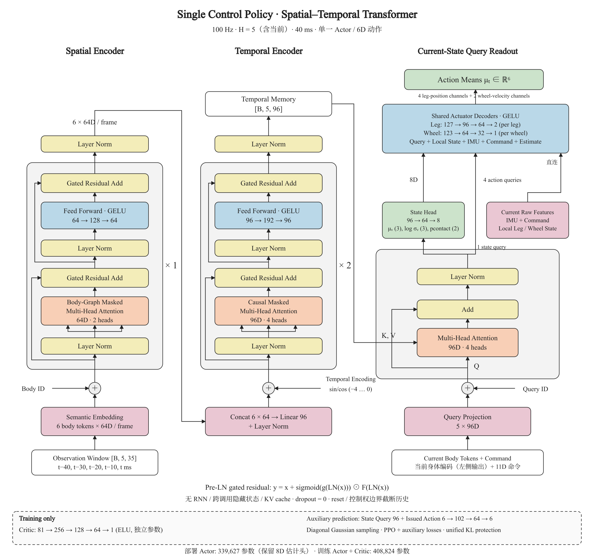

# 网络架构

本文描述 `formal/policy.py` 的单一运动控制策略。任务、课程与仿真组装见[系统架构](ARCHITECTURE.md)，启停与评价见[使用说明](USAGE.md)。研究网络保留在 `research/`，不混入本结构。

## 输入与输出

Actor 每10ms读取一帧，输入按旧到新排列的 `B × 5 × 35` 原始观测；包含当前帧，跨度40ms，不额外等待历史。轮角度的两个兼容槽固定为0，也不进入编码器。

| 每帧分组 | 维数 | 内容 |
|---|---:|---|
| 命令 | 11 | 速度/转向/高度命令、5维模式、请求高度与命令时钟 |
| 机身 | 6 | 机身角速度、重力方向 |
| 左腿 / 右腿 | 各6 | 两个同轴输出坐标的位置、速度、上一发出动作 |
| 左轮 / 右轮 | 各2 | 轮速、上一发出动作 |
| 保留槽 | 2 | 轮角度恒0，不参与推理 |

输出为6维原始动作均值：左腿2维、右腿2维、左右轮各1维。环境将前四维映射为输出轴位置目标，后两维映射为轮速目标；电机链传动、限幅和控制响应由控制层处理。部署使用同一个Actor完成全部任务，模式作为输入，不切换模型。

## 主干与解码

[矢量框图](figures/formal-policy.svg) · [绘图源码](figures/formal-policy.py)。版式参考 [Attention Is All You Need, Fig. 1](https://arxiv.org/abs/1706.03762)，模块与连线按本仓库实现绘制。

**空间编码。** 命令、机身、左右腿、左右轮分别成为6个token，加入身体身份嵌入；左右腿共享输入投影，左右轮共享输入投影。图mask允许自身、命令/机身与所有节点、同侧腿轮、左右腿之间、左右轮之间交互。每帧6个64D输出拼接后投影为一个96D时间token。

**时间编码。** 加入相对位置 `−4…0` 的正弦/余弦编码。两层Pre-LN注意力使用下三角mask：位置 `i` 只能看 `j ≤ i`。残差为 `y = x + sigmoid(g(LN(x))) × F(LN(x))`；门控只跨网络深度，初始bias为−2，无跨调用记忆。dropout为0，不使用RNN或KV cache。

**Query解码。** 当前身体token与11D命令生成左右腿、左右轮及机身状态共5个96D Query，读取已完成的五帧时间编码。状态Query输出8维：3维机身线速度均值、3维对数标准差、2维轮接触概率。线速度参考点为 `base_link` 原点，表达在机身坐标系。

动作解码器同时读取Query、当前局部原始状态及共享的25D信息（机身6 + 命令11 + 估计8）：

| 分支 | 网络维度 | 参数共享 |
|---|---|---|
| 腿 | `127 → 96 → 64 → 2` | 左右共享，分别输出两维 |
| 轮 | `123 → 64 → 32 → 1` | 左右共享，分别输出一维 |
| 状态估计 | `96 → 64 → 8` | 一个状态Query |
| 下一步预测，仅训练 | `102 → 64 → 6` | 状态Query96 + 已发出动作6 |

解码和辅助MLP使用GELU；腿/轮输出层按0.01缩放初始化。下一步预测目标为六个输出坐标的速度变化，不是额外动作。

## 历史、监督与PPO边界

窗口索引在回合或控制权变化处截断；不足五帧时复制新边界首帧，不取边界前的数据。原生运行交回RL还需满足新鲜观测条件。网络接收构造好的完整窗口，不用缓存latent代替当前权重重算；minibatch可打乱窗口端点，窗口内部保持顺序。

Actor只能使用可部署观测。81D Critic为独立的 `81 → 256 → 128 → 64 → 1` ELU MLP，与Actor不共享参数。特权线速度、接触和速度变化只提供训练标签，不直接输入动作头。

训练分布为对角高斯：`a_raw ∼ Normal(μ(H), σ)`。采样时保存原始动作、旧均值/标准差和log概率，环境之后才限幅。PPO、速度NLL、接触BCE和下一步预测合成一次Actor更新；KL检查及回滚同时覆盖共享编码器和辅助更新。Actor、辅助标签、GAE传播与value bootstrap各有独立mask，具体边界由 `formal/learning/contracts.py` 定义。

## 参数量与部署

默认配置的实际参数计数如下；结构变更后以代码及对应检查为准。

| 部分 | 参数量 |
|---|---:|
| 训练Actor（含探索参数与预测头） | 346,615 |
| 独立Critic | 62,209 |
| 训练总量 | **408,824**（上限450,000） |
| 部署Actor | **339,627** |

部署移除Critic、高斯采样/探索参数及下一步预测头，保留参与动作生成的8D状态估计头。输入缩放、输出轴顺序、历史与控制时序必须与训练一致。五帧是否足以处理滑移和时延、实际推理耗时及Sim2Real表现仍需物理和人工评价，参数量不代表这些检查已通过。

源码入口：[网络](../src/transformer_rl/formal/policy.py) · [观测与缩放](../src/transformer_rl/formal/control/observation.py) · [窗口与mask](../src/transformer_rl/formal/learning/contracts.py) · [PPO](../src/transformer_rl/formal/learning/optimization.py)。
